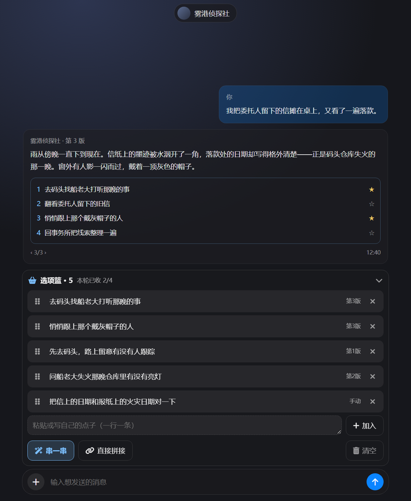
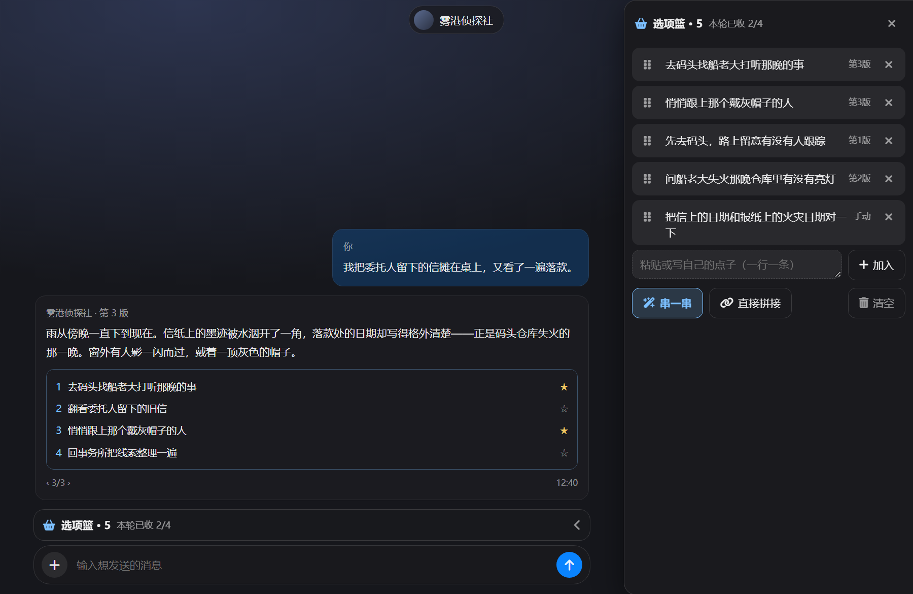
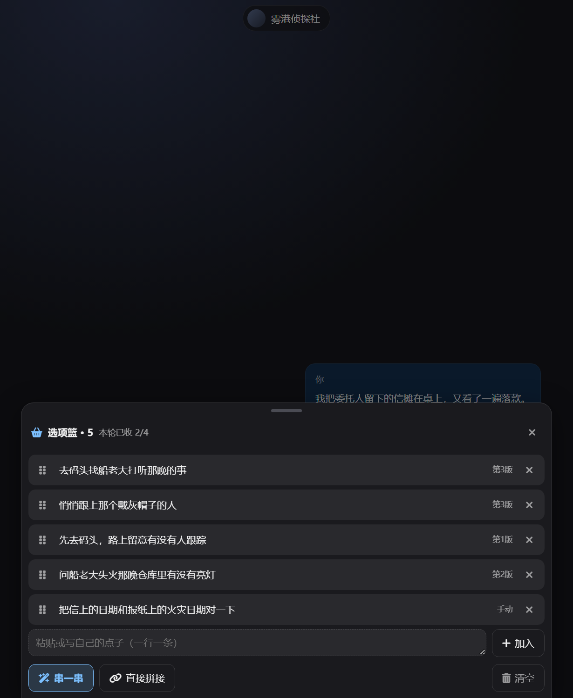

# 选项篮（SillyTavern Option Basket）

重 roll 的时候，每一版回复都会给出几个行动选项。有的选项重复、细节不同，有的各不相同，想要的往往散在好几版里。这个扩展提供一个篮子：一边重 roll 一边把看中的选项收进去，排好顺序，再直接拼接，或者让 AI 把它们串成通顺的一段，填进输入框，由你修改后再发送。

## 三种布局

在扩展设置里切换，三种布局用的是同一个篮子。截图在演示页面中拍摄，角色和剧情是示例内容；实际的酒馆界面随主题不同。

### A 输入框上方展开

篮子贴在输入框上方，点标题行原地展开或收起。



### B 右侧抽屉

篮子从右边滑出。宽屏（≥900px）不加遮罩，可以一边看正文一边整理，用 ×、Esc 或再点输入框上方的标题行收起；窄屏会加遮罩，点遮罩也能收起。



### C 底部弹出面板

篮子从底部升起，最高占屏幕 3/4。按住顶部小横条往下拖超过约 80 像素松手就会收起（触屏可用），也可以点遮罩、× 或按 Esc。



## 安装

在 SillyTavern 里打开「扩展 → 安装扩展」，填入：

```
https://github.com/Aprogues/SillyTavern-Option-Basket
```

开发和日常使用环境是 SillyTavern 1.19.0，更早的版本没有测试过。

## 用法

1. **收集**
   - 如果卡片用选项面板显示选项，并且扩展能访问到这个面板（见下方「兼容性」），每个选项右边会出现 ☆，点一下收进篮子，再点一下移出。
   - 篮子里的「本轮选项」也能点星收集。默认只在最新回复的选项面板加不上星时显示，可以在设置里改成总是显示或从不显示。
   - 篮子底部的输入框可以粘贴或手写自己的点子，一行一条。
   - 和篮子里已有内容重复的（忽略空格和大小写）不会再加一遍。
2. **整理**
   - 按住每条左边的 ⋮⋮ 拖动排序，支持触屏。
   - 点文字可以直接修改，点 × 移出。
   - 每条后面标着来源：来自最新回复的显示「第几版」，来自更早楼层的显示「#楼层号」，自己加的显示「手动」。
3. **输出**
   - 「直接拼接」：按顺序每条一行连起来，不调用模型。
   - 「串成一段」：发一次小请求，让模型去掉重复、补上必要的过渡，写成一段。
   - 两种结果都会填进输入框，不会自动发送。输入框里原本有字的话，结果会另起一行接在后面。
4. **清理**：点「直接拼接」或「串成一段」时，篮子里当时的全部条目都记为已用。随后发出的消息如果还保留着填进去的内容的开头，这些条目会自动移出篮子，之后新加的条目会留下；如果你把开头改掉或删掉再发，篮子不动。可以在设置里关闭这项。

篮子存在当前聊天的元数据里，随聊天文件保存：同一个酒馆在不同设备上打开同一个聊天，看到的是同一个篮子（另一台设备要重新打开这个聊天才会更新；两边同时改时以后保存的为准）。换一个聊天就是另一个篮子。篮子展开或收起的状态只存在本机。

## 设置（扩展设置 → 选项篮）

### 「串成一段」用哪个模型

| 方式 | 说明 |
|---|---|
| 跟随当前连接 | 用聊天正在用的渠道和密钥，可以只换一个模型名。只支持聊天补全类 API。 |
| 酒馆的连接配置 | 从「连接配置」里存过的接口中选一个，密钥由酒馆保管，也可以换模型名。需要启用酒馆自带的「连接配置」扩展。 |
| 自定义接口 | 填 OpenAI 兼容的接口地址、密钥和模型名，可以点「拉取模型」从接口获取模型列表。 |

- 所有请求都由酒馆后台转发，不会被浏览器的跨域限制拦下。所以自定义接口的地址要能从运行酒馆的那台机器访问到（比如 `localhost` 指的是酒馆所在的机器）。地址填到 `/v1` 为止即可，末尾多写的 `/chat/completions` 会被自动去掉。
- 自定义接口的密钥会以明文存进酒馆的设置文件。更稳妥的做法是先在酒馆的「连接配置」里存好，再用第二种方式。
- 自定义接口没填密钥时，扩展会发一个空的认证头，避免酒馆把它为自己的自定义接口保存的密钥发给你填的地址。
- 对部分渠道（Google AI Studio、Vertex AI、OpenAI、OpenRouter、xAI、DeepSeek、Fireworks、NanoGPT），请求会附带「尽量少思考」的参数，免得思考模型把输出额度用在思考上；其他渠道不附带。自定义接口只有在酒馆认得模型名时才会把这个参数转发出去，所以经自定义接口接的思考模型多半不受影响。

### 其他选项

- **剧情上下文**：默认取最新 AI 回复里最后一个 `<progress>` 中以「概括：」开头的那一行；没有的话，附上回复结尾约 500 字（去掉思考块、选项块和标签符号后；如果回复结尾是状态栏，附上的就是状态栏文字）。也可以设成只发选项。
- **串联提示词**：可以改成自己的版本，有恢复内置提示词的按钮。
- **布局、配色**：配色默认跟随酒馆主题，也可以选固定深色。

### 选项识别（换卡时可能要改）

- **标签名**：默认识别 `<option>……</option>` 里的内容，一行算一个选项，取回复里最后一处。多个标签名用逗号或空格分开；标签不能带属性。
- **自定义正则**：给格式特殊的卡用，填了就不再看标签名。第 1 个捕获组当作选项块（没有捕获组就用整个匹配），取回复里最后一处。写成 `/…/flags` 或直接写正则内容都可以（后者默认不区分大小写）；正则写错时会退回用标签名。
- **选项面板按钮选择器**：默认 `.option-button`，用来在卡片的选项面板上加星。
- 行首常见的编号和符号会自动去掉，比如 `1.`、`①`、`>`、`-`、`选项一：`。
- 「用最新回复测试识别」按钮检查当前的标签名或正则能不能认出最新一条回复里的选项（不检查选项面板选择器）。

## 兼容性

- **选项面板**：扩展会在聊天消息里的同源 iframe（比如酒馆助手 / JS-Slash-Runner 渲染的面板）中查找选项按钮并加星，默认找带 `.option-button` 类的按钮（比如「鱼冰选项美化」正则生成的面板）。别的 iframe 面板改上面的选择器即可；直接写在消息正文里、不在 iframe 中的按钮加不了星，这时用篮子里的「本轮选项」。
- 「本轮选项」、识别测试和剧情上下文只看当前聊天的最后一条消息，而且它必须是 AI 回复（最后一条是你发的消息时不显示）。选项面板上的星会加在聊天里所有能访问到的面板上。

## 许可证

[MIT](LICENSE)
